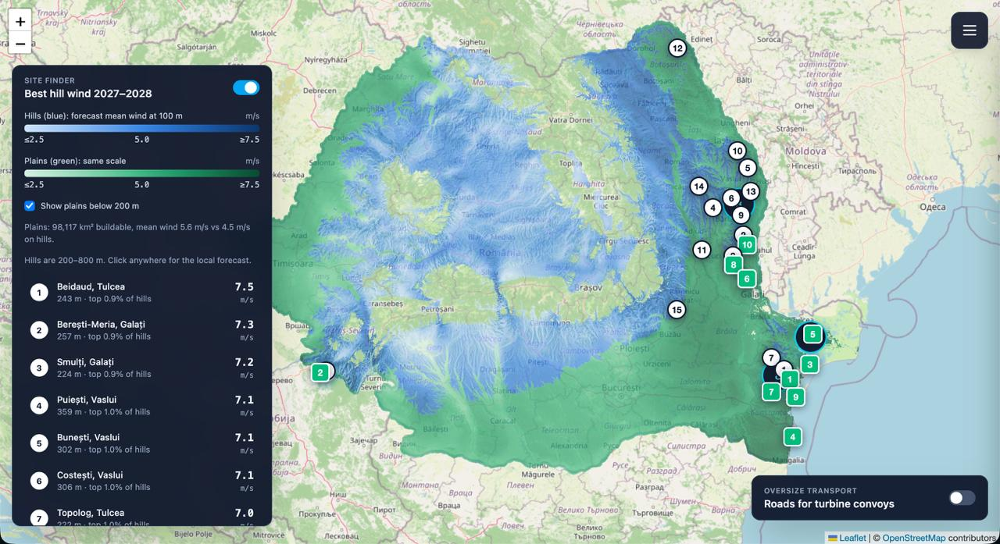
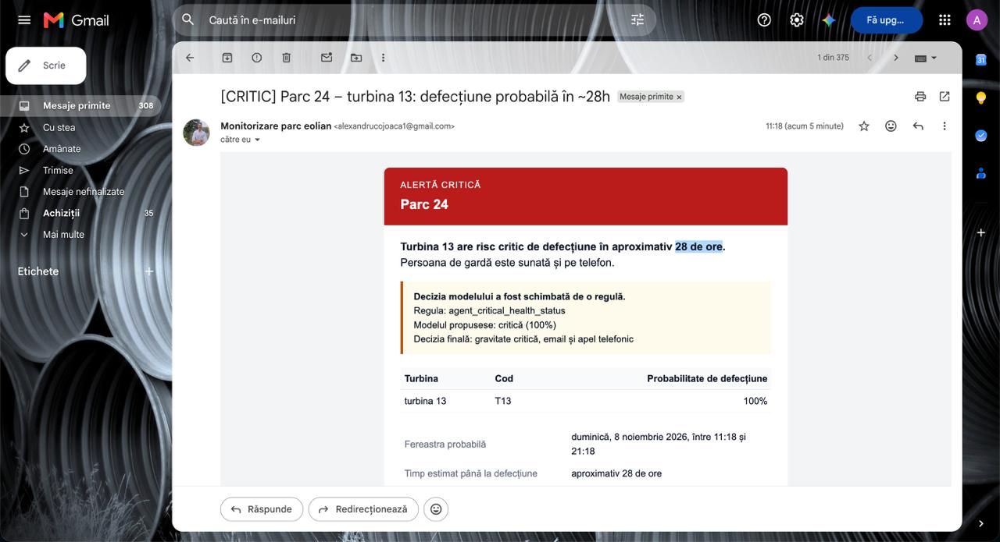
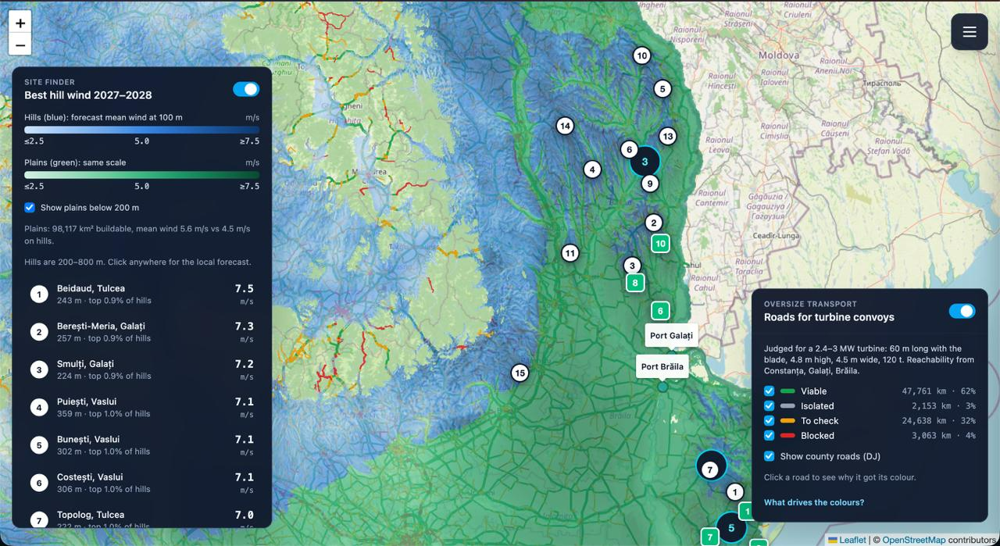
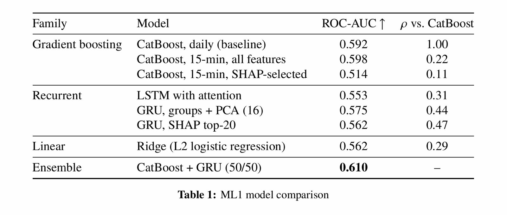

# Smarthack

A wind energy platform for Romania. It watches the telemetry of running turbines, predicts
which ones will fail in the next 7 days, and lets an agent decide who gets an email and who
gets a phone call. On the planning side, it maps where the wind will be strongest over the
next two years, on hills and on plains, and which roads a turbine convoy can actually use
to get there.



## What it does

### 1. Predictive maintenance and alerting

Turbine telemetry feeds two models:

- **Expected production.** A model running in a local Lambda function takes the weather
  forecast (from an API) and the turbine telemetry, and returns the energy each turbine is
  expected to produce.
- **Failure risk.** A second model reads the same telemetry and gives, for each of the next
  7 days, the probability that the turbine fails and the subsystem most likely to cause
  it, such as the hydraulic group, the generator bearing, the gearbox or the transformer.

Both outputs go into a decision agent (LangGraph). It ranks the turbines at risk, matches
them with the crews available in their park and, when there are more failures than crews,
uses the expected production to repair first the turbine that would lose the most energy.
Then it sends the alert: an email work order for a warning, an email **and** a phone call
to the on-call person for a critical failure.

Each park shows its turbines and their health status for the day:


A critical alert, as the on-call person receives it. It gives the turbine, the time
window of the probable failure and why the agent decided as it did:



### 2. Site finder: wind over the next two years

A statistical calculation, not a machine learning model, estimates the mean wind speed at
100 m for 2027–2028 in every zone of Romania, split into **hills** (200–800 m, in blue) and
**plains** (below 200 m, in green). It ranks the best hill sites, with Beidaud (Tulcea) at
7.5 m/s at the top, and compares the two terrains: 98,117 km² of buildable plains average
5.6 m/s, against 4.5 m/s on hills. Clicking anywhere on the map gives the local forecast.

### 3. Oversize transport

A turbine of 2.4–3 MW travels as a 60 m blade, 4.8 m high, 4.5 m wide and 120 t. The
transport layer rates every road reachable from the ports of Constanța, Galați and Brăila
for such a convoy: viable (62% of the network), to check (32%), blocked (4%) or isolated
(3%). Clicking a road explains its colour.



## The failure model

Several model families were compared on the failure prediction task. The final model is a
50/50 ensemble of CatBoost and a GRU, the best by ROC-AUC. The last column is the rank
correlation of each model's scores with the CatBoost baseline.



## Architecture

The diagrams are in [`docs/diagrams/`](docs/diagrams/). Open
[`arhitectura_pipeline.drawio`](docs/diagrams/arhitectura_pipeline.drawio) in
[draw.io](https://app.diagrams.net) for the pipelines above. The layers of the code and
where new code goes are in [`docs/architecture.md`](docs/architecture.md).

| Part | Technology |
|---|---|
| API | FastAPI (Python 3.12) |
| Frontend | React, Vite, Tailwind CSS, Leaflet |
| Database | Supabase (PostgreSQL), migrations with Flyway |
| Failure model | CatBoost + GRU |
| Decision agent | LangGraph, Gemini API |
| Alerts | Email, phone calls through Twilio |
| Weather | Open-Meteo forecast, ERA5 history |
| Data lake | Local folders that stand in for S3 buckets: `raw`, `features`, `predictions`, `dispatch` |

## Quick start

Python 3.12 or newer.

```bash
python -m venv .venv && source .venv/bin/activate
make install          # editable install with the dev and docs extras
make hooks            # git pre-commit hook
cp .env.example .env
make lint && make test
python -m smarthack
```

## Run everything

```bash
make up                       # or: python scripts/run_all.py
```

Checks `.env` and dependencies, applies Flyway migrations, then starts the API (:8000), the
frontend (:5173), the maintenance worker and the wind forecast worker. Ctrl+C stops all.
Options: `--skip-migrate`, `--no-web`, `--no-workers`, `--prod`, `--port N`.

## Try the alert pipeline

Start the lake watcher, then drop a telemetry file into the `raw` bucket. The file goes
through `raw` → `features` → `predictions` → `dispatch`, and a critical turbine ends in an
email and a phone call.

```bash
python -m smarthack.jobs.lake_job watch
python -m smarthack.jobs.lake_job put data/samples/turbina1_critica.csv --key demo/test_critic.csv
python -m smarthack.jobs.lake_job sample --turbine 3=hydraulic_leak --turbine 5=normal
```

The fault scenarios are `bearing_overheating`, `gearbox_wear`, `hydraulic_leak`,
`transformer_overheating` and `normal`. Use a new `--key` for every run.

## Layout

```
smarthack/        the package
  api/            FastAPI routes: parks, dispatch, resource, transport
  services/       business logic, the dispatch agent and the lake handlers
  clients/        Supabase, email, voice, object store
  maintenance/    failure model: features, predictor, simulator
  resource/       hill and plain wind atlas
  transport/      oversize transport road network
  jobs/           workers: maintenance, wind forecast, data lake
frontend/         React app: map, site finder, transport layer
db/migrations/    Flyway SQL migrations
models/           trained models and built artefacts
tests/            unit and integration tests
docs/             mkdocs site (make docs-serve)
```

`make help` lists every target. The architecture, the testing approach and the definition
of done are in [`docs/`](docs/index.md).

## Branches

| Branch | Role |
|---|---|
| `main` | Closed. Only receives releases, merged from `dev` through a pull request. |
| `dev` | **Protected.** Nothing is pushed to it directly: a change merges only through a pull request with **one approval** and green CI (`lint`, `test`, `docs`, `docker`). |
| `feature/<name>`, `fix/<name>` | Where the work happens: branch from `dev`, open the pull request into `dev`. |

The full workflow and the definition of done are in [`docs/contributing.md`](docs/contributing.md).

## Tooling

| What | Where |
|---|---|
| Dependencies, core and extras, exact pins | `pyproject.toml` |
| black, isort, flake8, mypy, docstring coverage | `make lint` |
| Git hook (black, isort, flake8) | `.pre-commit-config.yaml` |
| Environment variables, every one | `.env.example`, read only in `smarthack/config.py` |
| Image: build, production, serving | `Dockerfile` |
| CI: lint, test, docs, docker | `.github/workflows/ci.yml` |
