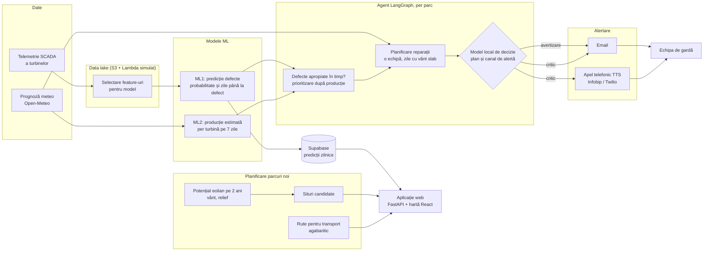

# Smarthack

TODO: what this application does, in one or two sentences.



## Quick start

Python 3.12 or newer.

```bash
python -m venv .venv && source .venv/bin/activate
make install          # editable install with the dev and docs extras
make hooks            # git pre-commit hook
cp .env.example .env
make lint && make test
python -m smarthack
```

## Run everything

```bash
make up                       # or: python scripts/run_all.py
```

Checks `.env` and dependencies, applies Flyway migrations, then starts the API (:8000), the
frontend (:5173), the maintenance worker and the wind forecast worker. Ctrl+C stops all.
Options: `--skip-migrate`, `--no-web`, `--no-workers`, `--prod`, `--port N`.

## Layout

```
smarthack/        the package: config, constants, utils, entry point
tests/unit/       fast tests, plus the guards that check the repository itself
tests/integration/
docs/             mkdocs site (make docs-serve)
```

`make help` lists every target. The architecture, the testing approach and the definition
of done are in [`docs/`](docs/index.md).

## Branches

| Branch | Role |
|---|---|
| `main` | Closed. Only receives releases, merged from `dev` through a pull request. |
| `dev` | **Protected.** Nothing is pushed to it directly: a change merges only through a pull request with **one approval** and green CI (`lint`, `test`, `docs`, `docker`). |
| `feature/<name>`, `fix/<name>` | Where the work happens: branch from `dev`, open the pull request into `dev`. |

The full workflow and the definition of done are in [`docs/contributing.md`](docs/contributing.md).

## Tooling

| What | Where |
|---|---|
| Dependencies, core and extras, exact pins | `pyproject.toml` |
| black, isort, flake8, mypy, docstring coverage | `make lint` |
| Git hook (black, isort, flake8) | `.pre-commit-config.yaml` |
| Environment variables, every one | `.env.example`, read only in `smarthack/config.py` |
| Image: build, production, serving | `Dockerfile` |
| CI: lint, test, docs, docker | `.github/workflows/ci.yml` |
