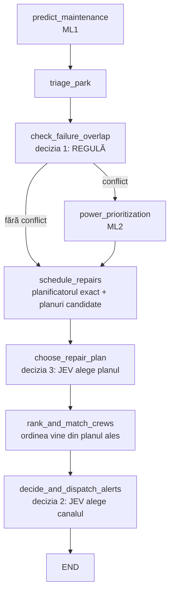

# Modele Jev față de regulile agentului: comparație și locul lor în pipeline

Data: 2026-11-08. Toate cifrele sunt măsurate local, pe MacBook M5 (24 GB, MPS). Metodologia,
etichetele și limitele sunt în [REPORT.md](REPORT.md); fișierele cu cifre sunt în
[results/](results/).

## Modelul ales: Jeffan 4B

[`tattrongvu/Jeffan-4B-2010`](https://huggingface.co/tattrongvu/Jeffan-4B-2010): 4.21B
parametri, licență Apache-2.0, ~9 GB memorie pe Mac și ~0.8–1.5 s pe decizie.

Ce decide și cu ce acuratețe:

| Ce decide Jeffan | Variante | Acuratețe | Comparat cu |
|---|---|---:|---|
| Cum trimitem alerta | doar email / email + apel / nimic | **0.938** (75 din 80) | regula de azi: 0.925 |
| Ce plan de reparații urmează echipa | 2–4 planuri calculate de cod | **0.883** pe prima turbină, **0.900** planul optim exact (54 din 60) | „cel mai urgent întâi”: 0.833; ordinea de azi: 0.450; planificatorul exact: 1.000 |
| Chemăm ML2? | – | nu decide Jeffan; rămâne regula (0.950) | Jeffan acolo: 0.650 |

De ce Jeffan și nu alt model Jev:

| Model Jev | Alertă (acuratețe) | AUC „apel” | Turbine CRITICAL fără apel | Aceeași alegere în 3 ordini | Plan, alegere între planuri | Plan, timeline brut | Memorie | Licență |
|---|---:|---:|---:|---:|---:|---:|---:|---|
| **Jeffan 4B** | **0.938** | 0.970 | 0 | 0.988 | **0.883** | 0.650 | 8.9 GB | Apache-2.0 |
| Perplexity Flash 4B | 0.912 | 0.975 | 0 | 0.988 | netestat | – | 9.5 GB | Apache-2.0 |
| Cerno 4B | 0.900 | 0.977 | 0 | 0.988 | netestat | – | 10.0 GB | Apache-2.0 |
| GLiDE 2B | 0.900 | 0.986 | 0 | 0.912 | netestat | 0.650 | 5.4 GB | Fastino Community |
| KnowLine 4B | 0.900 | 0.896 | 0 | 0.963 | netestat | – | 12.7 GB | Apache-2.0 |
| GLiDE 0.8B | 0.838 | 0.951 | 0 | 0.963 | netestat | – | 2.4 GB | Fastino Community |
| GLiDE 0.4B | 0.700 | 0.883 | 0 | 0.850 | netestat | – | 1.1 GB | Fastino Community |

Cifrele de la alertă sunt cu politica de azi scrisă în cerere. Fără ea, toate modelele scad la
0.45–0.68.

Ce a decis alegerea:
- **Jeffan are cea mai bună acuratețe la alertă**, fără nicio turbină CRITICAL lăsată fără apel,
  și își schimbă rar alegerea când schimbi ordinea opțiunilor.
- **Codul de rulare e cel mai simplu**: exemplul transformers din model card, fără pachet propriu
  de inferență. Pe Mac reproduce exemplul publicat cu o diferență de cel mult 0.002.
- **Licența e Apache-2.0**: nu are restricții comerciale, ca StartLux (CC BY-NC) sau GLiDE
  (Fastino Community, cu prag de venit).
- **Diferențele dintre modelele de top sunt mici.** Jeffan, Perplexity, Cerno, GLiDE 2B și
  KnowLine sunt la 1–3 cazuri unul de altul pe alertă, adică în zgomotul unui test de 80 de
  scenarii.
- **La alegerea planului, doar Jeffan a fost testat cu promptul bun** (alegere între planuri),
  la cererea ta. Ca să confirmăm că e și acolo cel mai bun, se pot rula Cerno și Perplexity pe
  aceeași variantă, ~5 minute fiecare.

## Cele trei decizii, pe scurt

| Decizie | Cine decide azi | Cel mai bun model Jev | Verdict |
|---|---|---|---|
| 1. Chemăm ML2? | regula de suprapunere: **0.950** | Cerno 4B: 0.838 | rămâne regulă |
| 2. Ce canal are alerta? | `classify_alert_channel`: **0.925** | Jeffan 4B: 0.938, aceeași decizie în 79/80 de cazuri | Jeffan poate intra, sub regula dură |
| 3. Ce turbină reparăm prima? | ordinea din `node_rank_and_match_crews`: **0.45** (planul exact: 1.000) | Jeffan 4B, alegând între planuri: **0.883** | Jeffan poate intra, ca judecător între planuri |

Cifrele sunt acuratețea față de răspunsul corect. La deciziile 1 și 2 răspunsul corect e
eticheta din `data/border_labels.json`; la decizia 3 e prima turbină din planul exact al
agentului.

## Decizia 1: chemăm ML2?

80 de scenarii. Coloana „cu politică” înseamnă că regula de azi e scrisă în cerere.

| Cine | Acc cu politică | Acc fără politică | AUC „da” | IÎ 95% acc față de regulă | Aceeași alegere în 3 ordini |
|---|---:|---:|---:|---|---:|
| **regula de azi** | **0.950** | 0.950 | **0.958** | – | 1.000 |
| Cerno 4B | 0.838 | 0.650 | 0.953 | [−0.188, −0.037] | 0.938 |
| GLiDE 2B | 0.750 | 0.637 | 0.888 | [−0.300, −0.100] | 0.950 |
| Perplexity Flash 4B | 0.700 | 0.625 | 0.839 | [−0.362, −0.138] | 0.988 |
| Jeffan 4B | 0.650 | 0.625 | 0.742 | [−0.425, −0.175] | 1.000 |
| KnowLine 4B | 0.637 | 0.613 | 0.748 | [−0.438, −0.200] | 0.988 |
| GLiDE 0.4B | 0.550 | 0.600 | 0.762 | [−0.512, −0.300] | 0.963 |
| GLiDE 0.8B | 0.512 | 0.438 | 0.852 | [−0.562, −0.312] | 0.912 |

Toate modelele sunt semnificativ sub regulă. Modelele nu recunosc din cifre că două turbine cad
în aceeași zi.

## Decizia 2: canalul alertei

80 de scenarii. „Încălcări” înseamnă o turbină CRITICAL lăsată fără apel.

| Cine | Acc cu politică | Acc fără politică | AUC „apel” | IÎ 95% acc față de regulă | Încălcări cu / fără politică | Aceeași alegere în 3 ordini |
|---|---:|---:|---:|---|---|---:|
| **Jeffan 4B** | **0.938** | 0.600 | 0.970 | [0.000, +0.037] | 0 / 0 | 0.988 |
| regula de azi | 0.925 | 0.925 | 0.941 | – | 0 / 0 | 1.000 |
| Perplexity Flash 4B | 0.912 | 0.675 | 0.975 | [−0.037, 0.000] | 0 / 0 | 0.988 |
| Cerno 4B | 0.900 | 0.637 | 0.977 | [−0.075, +0.025] | 0 / 1 | 0.988 |
| GLiDE 2B | 0.900 | 0.562 | **0.986** | [−0.100, +0.050] | 0 / 1 | 0.912 |
| KnowLine 4B | 0.900 | 0.625 | 0.896 | [−0.062, 0.000] | 0 / 1 | 0.963 |
| GLiDE 0.8B | 0.838 | 0.562 | 0.951 | [−0.163, −0.013] | 0 / 0 | 0.963 |
| GLiDE 0.4B | 0.700 | 0.450 | 0.883 | [−0.325, −0.125] | 0 / 0 | 0.850 |

Apel și email sau doar email, cu Jeffan cu politică (rânduri: răspunsul corect):

| | doar email | email + apel | nimic |
|---|---:|---:|---:|
| doar email (32) | 28 | 4 | 0 |
| email + apel (35) | 0 | 34 | 1 |
| nimic (13) | 0 | 0 | 13 |

- Jeffan face exact aceleași greșeli ca regula: 4 apeluri în plus, la încredere mică de la ML1,
  și fumul în nacelă ratat.
- Singura decizie diferită de regulă e scurgerea de ulei: email, cu probabilitatea 0.56.
- Fără politica scrisă în cerere, toate modelele scad la 0.45–0.68.

## Decizia 3: ce turbină reparăm prima

60 de scenarii, cu vânt pe 7 zile, ziua de defect și producția ML2 a fiecărei turbine.
Răspunsul corect e planul exact al agentului.

| Cine | Setul 1 (seed 7) | Setul 2 (seed 11) | AUC (seed 11) | Aceeași alegere în 3 ordini (seed 11) | Latență |
|---|---:|---:|---:|---:|---:|
| planificatorul exact (`schedule_repairs`) | 1.000 | 1.000 | – | 1.000 | ~0 |
| **Jeffan 4B, alege între planuri gata făcute** | – | **0.883** | **0.964** | **0.983** | 1.5 s |
| „cel mai urgent întâi” | 0.800 | 0.833 | 0.870 | 1.000 | ~0 |
| Jeffan 4B, timeline brut | 0.650 | 0.617 | 0.797 | 0.917 | 1.5 s |
| Jeffan 4B, cu cifre pe fiecare turbină | – | 0.617 | 0.790 | 0.900 | 1.7 s |
| GLiDE 2B, timeline brut | 0.650 | – | – | – | 0.6 s |
| ordinea de azi a agentului | 0.367 | 0.450 | 0.571 | 1.000 | ~0 |

Felul în care îi dai problema contează mai mult decât modelul:
- dacă îl lași să calculeze singur planul, Jeffan are 62%;
- dacă alege între planuri calculate de cod, are 88%;
- diferența e reală: interval bootstrap [+0.13, +0.40].

## Resurse

| Model | Memorie Metal | Încărcare | Latență per decizie (mediană) |
|---|---:|---:|---:|
| regula / planificatorul | 0 | 0 | ~0 |
| GLiDE 0.4B | 1.10 GB | 20.6 s | 45 ms |
| GLiDE 0.8B | 2.41 GB | 3.4 s | 242 ms |
| GLiDE 2B | 5.38 GB | 4.2 s | 306 ms |
| Jeffan 4B | 8.87 GB | 7.9 s | 815 ms |
| Perplexity Flash 4B | 9.48 GB | 7.1 s | 873 ms |
| Cerno 4B | 9.96 GB | 7.2 s | 1 179 ms |
| KnowLine 4B | 12.73 GB | 7.2 s | 1 644 ms |

## Unde intră Jev în pipeline

Graful de azi (`smarthack/services/agent/graph.py`), cu propunerea marcată:

### Decizia 1, `check_failure_overlap`: fără Jev

Rămâne regula. Singura schimbare propusă e în cod: o turbină cu `days_to_failure >= 8` sau fără
termen nu are o zi de defect și nu intră în `overlapping_failures`.

### Decizia 3, nod nou `choose_repair_plan`: Jev alege planul

Locul nodului: după `schedule_repairs` și înainte de `rank_and_match_crews`. Ordinea celor
două noduri vechi se inversează, pentru că ordinea turbinelor trebuie să vină din plan.

1. **Codul pregătește opțiunile.** `schedule_repairs` produce, ca azi, planul optim.
   - Lângă el, codul construiește 2–3 planuri alternative: „cel mai urgent întâi”, ordinea
     după producție și „cel mai îndepărtat întâi”. Planurile identice se elimină.
   - Pentru fiecare plan, codul calculează ce turbină se repară în ce zi, câte turbine salvează
     și câtă producție pierde (producție × vântul zilei de reparație).
2. **Jev primește:**
   - `state`: vântul pe 7 zile și turbinele, fiecare cu `health_status`, `failure_day`,
     `fault_probability` și `projected_mwh_7d`;
   - o singură întrebare `choice`, cu opțiunile `plan_A`, `plan_B`, ...; descrierea fiecărei
     opțiuni e planul în cuvinte;
   - instrucțiunea: „alege planul care salvează cele mai multe turbine; la egalitate, pe cel cu
     cea mai mică pierdere de producție”.
3. **Jev întoarce:** o probabilitate pentru fiecare plan. Planul ales și probabilitățile se
   loghează.
4. **Verificarea din cod**, care rămâne deasupra lui Jev: dacă planul ales salvează mai puține
   turbine decât optimul, se folosește optimul. La fel dacă modelul nu răspunde în timp.
5. **Ieșirea:** `repair_schedule` vine din planul ales, iar `prioritized_turbines` e ordonată
   după ziua de reparație din plan (turbinele care nu pot fi salvate, la final).
   `rank_and_match_crews` doar repartizează echipele în această ordine.

Pe testul cu seed 11, Jeffan alege exact planul optim în 54 din 60 de cazuri:
- într-un caz a ales un plan care salvează mai puține turbine; verificarea din cod îl prinde;
- în celelalte 5 a ales un plan care salvează la fel de multe turbine, dar pierde mai multă
  producție. Asta nu se poate prinde fără să anulăm alegerea modelului: e prețul de a-l lăsa să
  aleagă.

### Decizia 2, `decide_and_dispatch_alerts`: Jev alege canalul

Locul: înlocuiește apelul `classify_alert_channel(...)` din buclă, câte o cerere pentru fiecare
turbină.

1. **Jev primește:**
   - `state`: `park_id`, `turbine_id`, `health_status`, `days_to_failure`, `fault_probability`,
     `suspected_failure` și, mai târziu, notele tehnicienilor, dacă apar;
   - o întrebare `choice` cu `doar_email` / `email_si_apel` / `nimic`;
   - instrucțiunea: ce înseamnă câmpurile, plus politica de azi, scrisă (pragurile 0.30, 0.70
     și 2 zile). Fără politica scrisă, acuratețea cade la 0.60.
2. **Regula dură deasupra:** o turbină CRITICAL primește întotdeauna apel, orice ar spune
   modelul.
3. **Fallback:** dacă modelul nu răspunde, decide `classify_alert_channel`, ca azi.
4. **Mod de pornire:** propun întâi „umbră”. Regula decide, iar decizia lui Jev se loghează
   lângă ea. Se trece pe Jev doar după ce logurile arată că nu strică nimic.

### Cum rulează modelul

- **Unde**: un server local separat, care servește Jeffan în formatul System One
  (`POST /v1/systemone`) și rulează nativ pe Mac, cu MPS.
  - Nu în Docker: Docker pe Mac nu vede GPU-ul Metal, iar pe CPU un model de 4B ar fi mult mai
    lent. Asta e o estimare, nu am măsurat-o.
  - Memorie: aproximativ 9 GB.
- **Cum îl apelează agentul**: printr-un client HTTP cu timeout, în `smarthack/clients/`
  (rangul 2 din straturi).
  - Variabilele noi se citesc doar în `smarthack/config.py` și se documentează în
    `.env.example`: adresa serverului, `on` / `off` și modul `umbra` / `activ`.
- **Cât costă o rulare pe un parc**: o decizie de plan (~1.5 s) plus câte o decizie de canal
  pentru fiecare turbină cu defect (~0.8 s fiecare). Pentru un sweep zilnic e acceptabil.

### Ce nu face Jev

- Nu calculează planul, nu compară zile și nu decide singur dacă se cheamă ML2. La toate acestea
  codul e exact, iar modelul greșește.
- Pe datele de azi, Jev nu ia decizii mai bune decât codul. Merită când în cerere apar lucruri pe
  care codul nu le poate calcula, cum ar fi notele tehnicienilor sau restricțiile de acces la
  turbină. Atunci poate cântări planurile și canalul și după ele.
